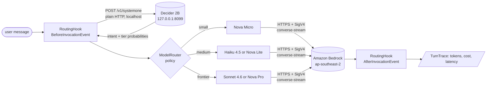
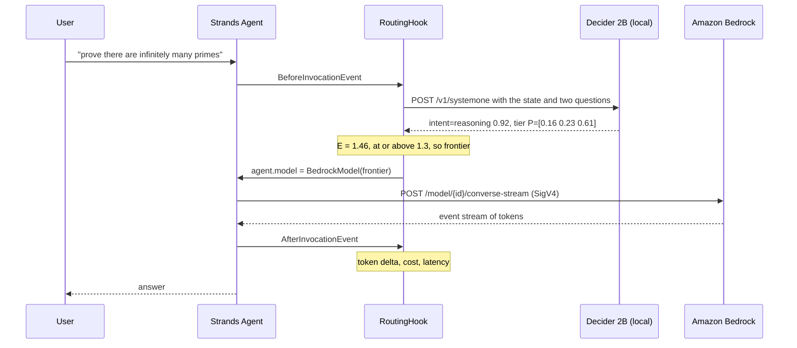
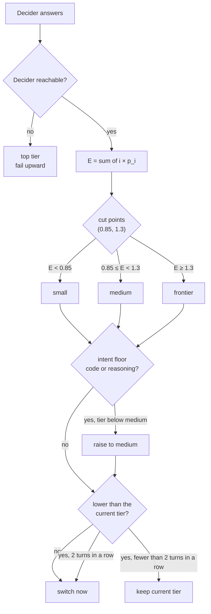
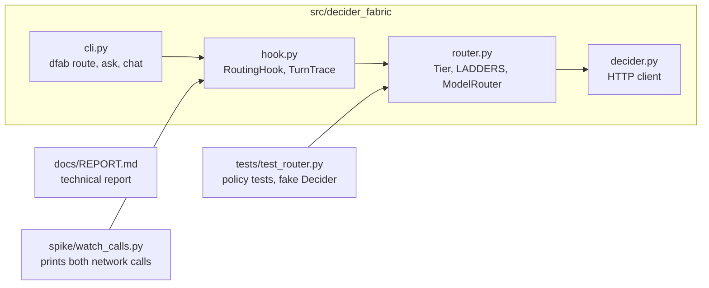

# dfab: decider-fabric

Route each turn of a [Strands](https://strandsagents.com) agent to the cheapest Amazon Bedrock model that can answer it. A local decision model, [Strands Decider 2B](https://github.com/strands-labs/strands-decider), makes the choice in about 160 ms with no token cost.

```python
router = ModelRouter(Decider(), LADDERS["anthropic"])
agent = Agent(hooks=[RoutingHook(router, region_name="ap-southeast-2")])
```

Built for the AWS Builder Center Strands Decider 2B hackathon. Decision pattern: `#model-routing`.

## Why route per turn

An agent that sends every turn to one model pays frontier prices for "thanks!" or gets weak answers to proofs. Asking an LLM to pick the model adds a full LLM call to every turn. Decider 2B is a 1.9B-parameter model that returns probabilities over options you send in the request and never generates text, so a routing decision costs one local forward pass.

## How it fits together



## What one turn sends over the network



## How the router picks a tier

One Decider request asks two questions. `intent` is a `choice` over `chat`, `lookup`, `writing`, `code`, and `reasoning`. `tier` is a `score` over one capability description per tier, cheapest first. Plain Python turns the answers into a route:



The policy borrows from IP routing. Intent floors work like QoS marking at a network edge. Hold-down works like BGP route flap damping, so the router moves up at once and moves down slowly. Falling back to the top tier works like a default route.

## Project layout



## Run it

You need an Apple-silicon Mac (or a CUDA or CPU machine), Python 3.12, [uv](https://docs.astral.sh/uv/), and AWS credentials with Bedrock access in `ap-southeast-2`.

1. Install the Decider server and this package:

	```bash
	git clone --depth 1 https://github.com/strands-labs/strands-decider vendor/strands-decider
	uv venv --python 3.12 .venv && source .venv/bin/activate
	uv pip install -e "vendor/strands-decider[mlx]" -e ".[dev]"
	```

2. Start the Decider in a separate terminal. The first start downloads about 4 GB of weights:

	```bash
	strands-decider serve StrandsAgents/strands-decider-2B-qwen3.5-v1-2610 --device mlx --port 8099
	```

3. Route and answer:

	```bash
	export AWS_REGION=ap-southeast-2
	pytest -q tests                                          # policy only, no server or AWS needed
	dfab route "prove there are infinitely many primes"      # the decision only
	dfab --ladder nova ask "what's the capital of Peru?"     # one routed turn
	dfab --ladder nova chat                                  # a routed conversation
	python spike/watch_calls.py "hey there" --ladder nova    # print every network call
	```

If you sign in with `aws login`, botocore needs its CRT extra. This package depends on `botocore[crt]`, so step 1 installs it.

## Model ladders

| Ladder | Small | Medium | Frontier |
|---|---|---|---|
| `anthropic` | `apac.amazon.nova-micro-v1:0` | `au.anthropic.claude-haiku-4-5-20251001-v1:0` | `au.anthropic.claude-sonnet-4-6` |
| `nova` | `apac.amazon.nova-micro-v1:0` | `apac.amazon.nova-lite-v1:0` | `apac.amazon.nova-pro-v1:0` |

To add a ladder, add a tuple of `Tier` objects to `LADDERS` in `src/decider_fabric/router.py`. Describe what each tier is good for in `good_for`, and keep model names out of it. The Decider reads every token in the rubric, and brand names shift the score.

## Status

The `nova` ladder answers end to end. The `anthropic` ladder routes, and its Bedrock calls wait on account access to Anthropic models. The cut points are hand-set from six prompts. `dfab bench`, which fits them to labelled data and compares cost and quality against an LLM router, comes next. Measurements and findings so far are in [the technical report](docs/REPORT.md).

## License

Apache-2.0.
